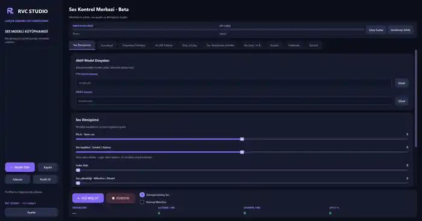

> **AMD Radeon 680M / ROCm gfx1035 EXPERIMENTAL BRANCH:** This is NOT the production RVC Studio release. It uses the original PTH/INDEX engine with AMD TheRock nightlies, separate Python environment, and mandatory real HIP GPU checks. Standard Windows ROCm PyTorch does not officially support Radeon 680M. AppSandbox GPU-PV may fail. See [ROCm 680M setup and limitations](docs/AMD_ROCM_680M_PREVIEW.md). **Do not install the normal NVIDIA/DirectML Setup.exe expecting ROCm.**

# 🎙️ RVC Studio

### Sesini değiştir. Seslerini yönet. Hepsi tek uygulamada.
**Windows için gerçek zamanlı yapay zekâ ses dönüştürme, Soundpad ve dosyadan dönüşüm.**

*Real-time AI voice conversion, soundboard, and offline conversion for Windows.*

### [⬇️ RVC Studio v1.5.2 Beta 1 — İndir / Download](https://github.com/skymoonai/rvc-voicechanger/releases/download/v1.5.2-beta.1/RVC_Studio_Setup_1.5.2_Beta1.exe)

[📦 Tüm sürümler / All releases](https://github.com/skymoonai/rvc-voicechanger/releases) · [📘 English](#english) · [🐛 Hata bildir / Bug reports](https://github.com/skymoonai/rvc-voicechanger/issues/new/choose)

---

## 🖥️ Uygulamadan bir görüntü / Preview

*Gerçek uygulama ekran görüntüsü · RVC Studio v1.5.1 Beta 1*

> [!IMPORTANT]
> **Ücretsiz ve kâr amacı gütmeyen bir beta projesi.** RVC Studio hâlen geliştirme aşamasındadır. Bazı bilgisayarlarda ses kesintileri, gecikme, hatalar veya çökmeler yaşanabilir. Önemli ses kliplerini, modellerinizi ve profillerinizi yedekleyin.

## 🇹🇷 RVC Studio nedir?

**RVC Studio**, RVC tabanlı ses modellerini günlük kullanım için erişilebilir hale getirmeyi amaçlayan Windows masaüstü uygulamasıdır. Farklı uygulamalar arasında geçiş yapmak yerine mikrofon dönüştürme, klip oynatma, model kütüphanesi ve ses dosyası dönüştürme işlemlerini tek arayüzden yönetebilirsiniz.

### ✨ Neler yapabilirsiniz?

| Özellik | Neler sunuyor? |
|:--|:--|
| 🎤 **Canlı ses dönüştürme** | Mikrofon sesini seçtiğiniz RVC modeliyle gerçek zamanlı işleme, dönüştürülmüş/normal mikrofon seçimi |
| 🎚️ **Model ve ses ayarları** | Pitch, ses karakteri, index rate, ses yüksekliği ve modele özel dönüşüm seçenekleri |
| 📚 **Ses modeli kütüphanesi** | PTH/INDEX seçimi, model profilleri, yeniden adlandırma, kaydetme ve paylaşılabilir profil verileri |
| 🔊 **Soundpad** | Ses kliplerini oynatma, klip düzenleme, zaman çizelgesinde tıklayarak atlama, mikrofona ve kulaklığa ayrı ses seviyesi |
| 💾 **Soundpad yedekleri** | Ses kliplerini ve ilgili ayarları **.rvcsoundpad** profiliyle dışa/içe aktarma |
| 🎹 **Klavye kısayolları** | Kullanıcının atadığı kısayollarla sesleri ve desteklenen işlemleri yönetme |
| 🎼 **Dosyadan dönüştürme** | Desteklenen ses dosyalarını RVC modeli üzerinden işleme ve çıktıyı dinleme |
| 🧪 **Ses testi / A-B** | Kısa ses testleri, yeniden dinleme ve farklı ayarları karşılaştırma |
| 🧹 **Ses temizleme ve kalite** | Gürültü/ses işleme ve kalite seçeneklerini ayrı bölümde düzenleme |
| 🎛️ **Giriş ve çıkış** | Mikrofon/kulaklık/sanal ses aygıtı seçimi, giriş/çıkış seviyeleri, sessize alma |
| 📊 **Canlı durum** | Gecikme, çıkarım süresi, GPU kullanımına ilişkin mevcut durum göstergeleri |
| 📂 **Kullanıcı profilleri** | Modeller ve ayarlar için sürümler arası taşıma ve yedekleme |
| 🌐 **TR / EN** | Türkçe ve İngilizce arayüz |
| 🖥️ **Sistem tepsisi** | Tepsiye küçültme, kapatma onayı ve arka planda kullanım seçenekleri |
| 🔄 **Güvenli güncelleme** | Uygulama içinden sürüm kontrolü, Ed25519 imzalı güncellemeler ve desteklenen son güncellemeyi geri alma |

### ⚡ Donanım seçenekleri

- **CPU:** Uyumlu işlemcilerde çalıştırma; performans modele ve sisteme göre değişir.
- **NVIDIA CUDA:** Kurucuda CUDA 11.8 / CUDA 12.8 tabanlı NVIDIA profilleri bulunur.
- **AMD / Intel DirectML:** Deneysel GPU seçeneği; performans ve destek cihazlara göre değişebilir.

> Gerçek zamanlı gecikme; ses sürücüsü, örnekleme hızı, seçilen model ve donanıma bağlıdır. Her bilgisayarda aynı performans garanti edilmez.

## ⬇️ Kurulum — 5 adımda başla

1. **[RVC Studio Setup.exe'yi indir](https://github.com/skymoonai/rvc-voicechanger/releases/download/v1.5.2-beta.1/RVC_Studio_Setup_1.5.2_Beta1.exe).** Güncel sürüm değişmiş olabileceği için [Releases sayfasını](https://github.com/skymoonai/rvc-voicechanger/releases) da kontrol edebilirsiniz.
2. **Windows 10/11 (64 bit)** bilgisayarınızda kurucuyu açın ve istediğiniz kurulum klasörünü seçin.
3. Donanımınıza uygun **CPU / NVIDIA CUDA / AMD-Intel DirectML** profilini seçin.
4. İlk kurulumda Python ve gerekli paketlerin indirilmesi için **internet bağlantısı ve yeterli disk alanı** sağlayın.
5. Mikrofon ve ses çıkışını ayarlayıp **kullanım hakkına sahip olduğunuz** bir RVC ses modeli ekleyin. Gerekiyorsa sanal ses kablosu yapılandırın.

> Sanal ses kablosu için VAC Lite veya mevcut başka bir sanal aygıt kullanılabilir. Üçüncü taraf ses kablolarının ve modellerin **kendi lisans koşulları** geçerlidir.

### 🔄 Güncelleme ve önceki sürüme dönme

**Ayarlar → Güncelleme ve Geri Alma** bölümünden Beta kanalını seçip güncellemeleri denetleyebilirsiniz. Güncelleme paketleri **imza ve dosya bütünlüğü doğrulamasından** geçer. Desteklenen kod güncellemelerinde son güncellemeyi geri almak mümkündür.

Yeni Python bağımlılıkları veya sürücüler gerektiren büyük değişikliklerde **yeni Setup.exe** ile kurulum gerekebilir. Ses modelleri, Soundpad klipleri ve profiller kullanıcı verisi olarak korunmak üzere tasarlanmıştır; yine de sürüm yükseltmeden önce yedek alın.

## 🛡️ Güvenlik ve sorumlu kullanım

RVC Studio'yu **izinsiz ses taklidi, dolandırıcılık, aldatma veya kimliğe bürünme** amacıyla kullanmayın. Sesini kullanacağınız kişilerden izin alın; modellerin ve üçüncü taraf bileşenlerin lisanslarına uyun. Güvenilir olmayan model dosyalarını çalıştırmayın.

Yazılım **beta olarak, olduğu gibi** sunulur; garanti verilmez. Projenin ticari amaç gütmemesi, geçerli yasaları veya üçüncü taraf lisanslarını ortadan kaldırmaz. Depodaki [MIT lisansı](LICENSE), bağımsız üçüncü taraf yazılımlar ve model ağırlıkları için otomatik kullanım hakkı sağlamaz.

Hassas verilerinizi herkese açık hata raporlarına eklemeyin. Güvenlik bildirimleri için [SECURITY.md](SECURITY.md) dosyasına bakın.

### 🐛 Sorun mu yaşadınız?

[**GitHub Issues üzerinden hata bildirin**](https://github.com/skymoonai/rvc-voicechanger/issues/new/choose). Bildiriminize sürümü, Windows sürümünü, CPU/GPU ve ses cihazlarını, hatanın tekrarlanma adımlarını ve **kişisel bilgileri ayıklanmış** hata metnini ekleyin.

---

## English

**RVC Studio** is a free, non-commercial **Windows voice changer and soundboard** built around RVC voice models. It combines real-time microphone conversion, offline file conversion, model profiles, Soundpad playback and editing, voice testing, audio device controls, Turkish/English UI, and signed updates with rollback.

### Features

- **Real-time RVC voice conversion:** pitch and model controls, processed/raw microphone toggle.
- **Soundpad:** play and edit clips, seek on the timeline, separate microphone/headphone gain, configurable shortcuts, portable .rvcsoundpad backups.
- **Offline file conversion and A/B voice testing** with playback.
- **Voice model library and portable profiles** for model-specific settings.
- **CPU, NVIDIA CUDA, and experimental AMD/Intel DirectML** hardware profiles.
- **Audio input/output settings, cleanup options, status meters**, and system-tray controls.
- **Signed application updates and supported rollback**, with checks for downloaded packages.

### Download and install

**[⬇️ Download RVC Studio v1.5.2 Beta 1 for Windows](https://github.com/skymoonai/rvc-voicechanger/releases/download/v1.5.2-beta.1/RVC_Studio_Setup_1.5.2_Beta1.exe)**

Use Windows 10/11 x64. Run the installer, choose an installation path and compute backend, allow the initial dependency downloads, then configure your input/output devices and load a properly licensed voice model.

This is **beta software**: bugs, crashes, audio glitches and incompatibilities may occur. Back up important data. Use voice conversion responsibly and respect consent, copyright and third-party licenses.

[**All releases**](https://github.com/skymoonai/rvc-voicechanger/releases) · [**Report an issue**](https://github.com/skymoonai/rvc-voicechanger/issues/new/choose) · [**Changelog**](CHANGELOG.md) · [**Security**](SECURITY.md)

---

**RVC Studio · Open beta · Windows**

Yararlı bulduysanız ⭐ repo'ya yıldız bırakabilirsiniz. / If you find it useful, consider starring the repository.

## Kaynak Kod / Source Code

Python kaynak kodlari bu depoda. Gelistirici rehberi: [README_SOURCE.md](README_SOURCE.md).

